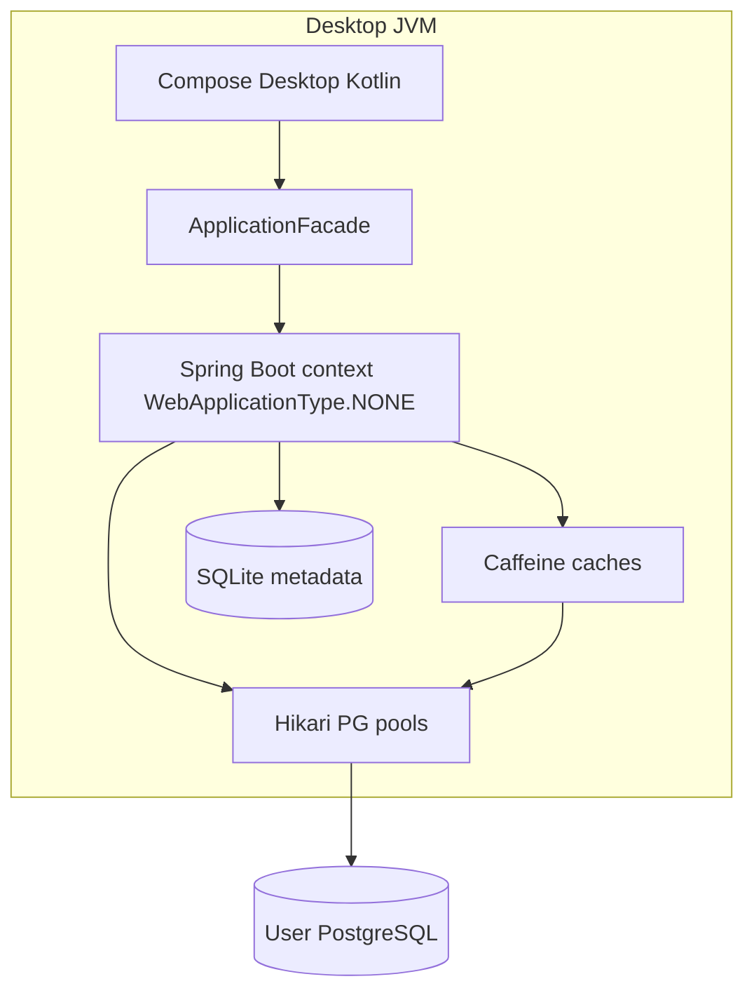

# DataWeave Architecture

## Context

Offline-first **cross-platform desktop** (Windows, Linux, macOS) for PostgreSQL exploration and dataset construction. **SQLite** holds local app metadata; **PostgreSQL** (user-provided) holds business data.

## Process model

Single desktop JVM:

**No HTTP server** is started for UI communication. Compose calls Spring beans directly via `DesktopSession`.

## Modules

| Module | Role |
|--------|------|
| `backend` | Java 21, Spring Boot, JDBC, Flyway (SQLite), caching, PostgreSQL access |
| `desktop` | Kotlin Compose UI, embeds backend |

## Data flow (table browse)

1. UI requests page → `ApplicationFacade.fetchTablePage`
2. `TableDataService` checks request generation (stale guard) → `TableDataCacheGateway`
3. On miss: JDBC **SELECT … LIMIT/OFFSET** (or keyset order when PK exists) via Hikari
4. Rows returned asynchronously to Compose state on `Dispatchers.IO`

## Caches

| Cache | Purpose | Invalidation |
|-------|---------|--------------|
| `metadata` | Schemas, tables, columns | `refreshSchema()` bumps version; connection delete |
| `dataPages` | Recent table pages | Schema version in key; connection invalidation |
| `datasetPreview` | Column-filtered previews | Preview scope generation + schema version |
| `queryResults` | Read-only SELECT (max 500 rows) | Schema version; not used for writes |

Diagnostics: `ApplicationFacade.cacheDiagnostics()` (hits/misses/evictions/size — no row data).

## Credentials

- Passwords stored via `CredentialVault` — OS-specific implementations in `src/windows`, `src/macos`, `src/linux` java source sets (see [PLATFORMS.md](./PLATFORMS.md)).
- Fallback in-memory vault with WARN when no OS integration is available.

## Local metadata path

Default: `~/.dataweave/metadata.db` (override with `dataweave.metadata.jdbc-url`).

## Roadmap alignment

Implemented slice: connections, metadata browse, paginated grid. Dataset builder, SQL console, exports, editing — **planned** (see `docs/IMPLEMENTATION_ROADMAP.md`).
