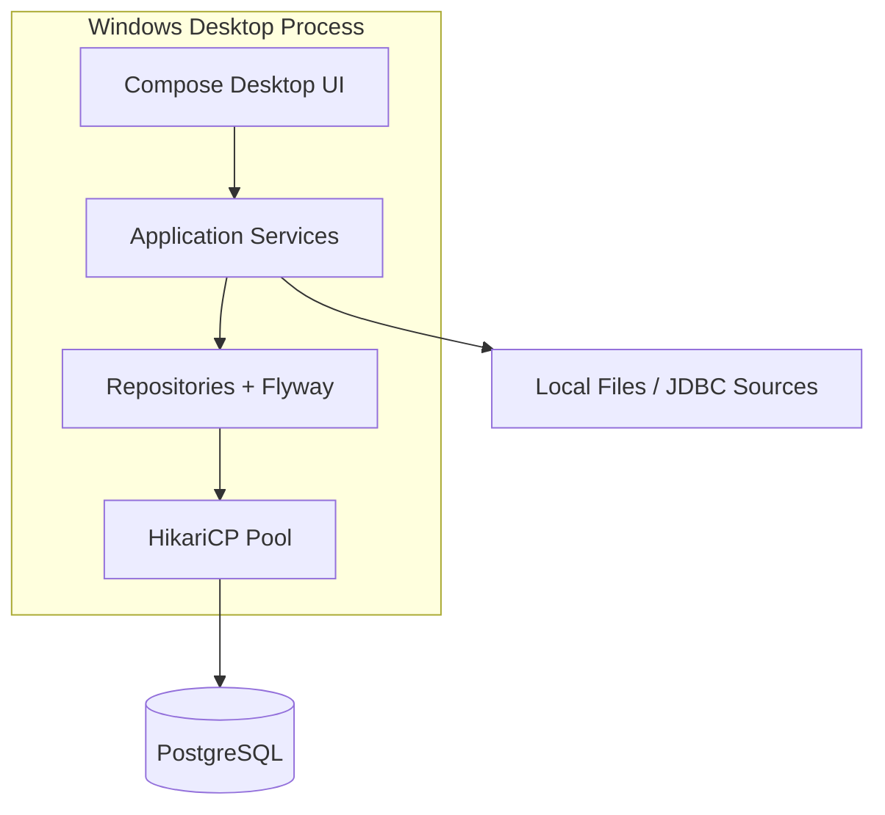

# DataWeave Architecture

## Context

DataWeave is an offline-first **Windows desktop** application. **PostgreSQL** is the authoritative store for catalog metadata (projects, and later pipelines, runs, and connection profiles). User data files remain on disk; the database holds pointers, schemas, and operational history.

## Logical view



## Layers

| Layer | Responsibility | Session 1 modules |
|-------|----------------|-------------------|
| UI | Navigation, forms, future virtualized grid | `com.dataweave.app.ui` |
| Application | Validation, use cases | `ProjectService` |
| Persistence | SQL, migrations | `ProjectRepository`, Flyway `V1__init.sql` |
| Infrastructure | Pooling, embedded dev DB | HikariCP, optional embedded Postgres |

## Performance architecture (planned)

- **UI thread**: Compose state only; all I/O on `Dispatchers.IO`.
- **Preview grid (future)**: windowed reads, columnar cache, cancelable sampling jobs.
- **Execution (future)**: bounded worker pool, spill-to-disk for large transforms, PostgreSQL for run metadata only (not bulk fact storage).
- **Measurements**: startup, project list query, sample load — recorded before tightening budgets in `docs/performance-budget.md`.

## Offline-first rules

1. No network call on critical path for v0.1 features.
2. Migrations run locally at startup; app refuses to run if schema version incompatible.
3. Sync (future) is asynchronous and never blocks local saves.

## Repository layout

```
app/src/main/kotlin/com/dataweave/
  app/          # Entry, runtime config, UI root
  domain/       # Pure models
  persistence/  # JDBC + Flyway bootstrap
  service/      # Use cases
app/src/main/resources/db/migration/
docs/           # PRD, ADRs, release process
```

## Deployment target

Primary artifact: **MSI** (Compose `nativeDistributions`). Development builds run on Linux/macOS/Windows with JVM 21.
